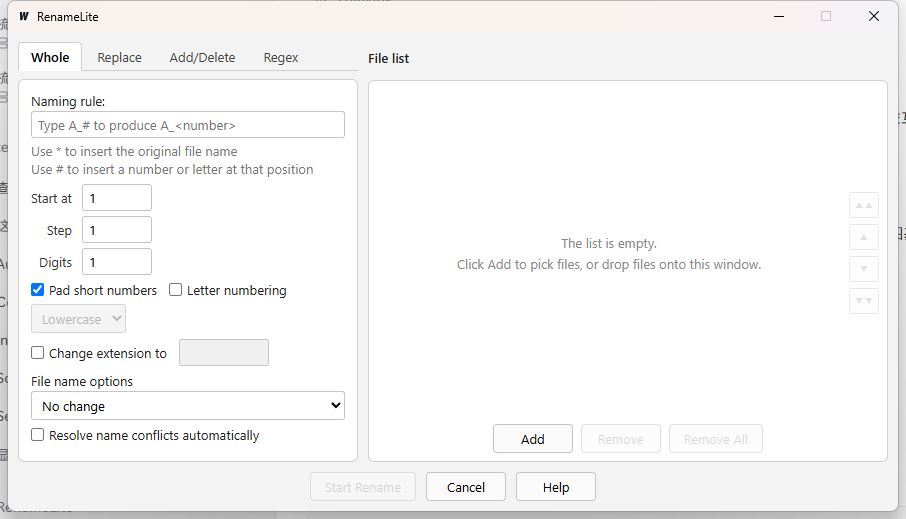

# BadRename 界面设计基准

其他设计参考截图：[Replace](design-original-replace.png)、[Add/Delete](design-original-add-delete.png)、[Regex](design-original-regex.png)。四张图片是历史版本的 Windows 桌面空列表截图，实际窗口为 906 × 519 像素，截图不能证明当前程序的行为。

[Whole 页与空列表](mygo-final-empty.png)为 Windows 桌面截图。[Whole](mygo-headless-whole-3458a469.png)、[Replace](mygo-headless-replace-429e9cbb.png)、[Add/Delete](mygo-headless-add-delete-429e9cbb.png)、[Regex](mygo-headless-regex-v2.png) 为 890 × 479 DIP 内容区的无窗口渲染预览，不含系统标题栏，不能代替桌面截图。图片供界面布局与交互设计参考。

## 窗口与视觉

- 标题 BadRename；系统标题栏、固定大小、不可手动缩放。内容区为 890 × 479 DIP；实际像素尺寸随显示缩放变化。
- 主区两列：左侧规则约 340 逻辑像素，右侧文件区约 520，间距 10，外围上/左/右各约 10；两侧白色圆角细灰边框的主体顶部与底部对齐。整体浅灰背景，深色文字，13px Segoe UI 或系统字体。
- 左上四标签 Whole、Replace、Add/Delete、Regex；当前标签白底加粗，与内容面板连接。页面共享同一高度，切换时窗口和底部按钮不跳动。
- 右上 File list 标题；面板内为列表和右侧纵向移动按钮，下方居中 Add、Remove、Remove All。窗口底部居中 Start Rename、Cancel、Help。
- 输入框、下拉框、按钮采用简洁浅色系统控件外观、细边框、轻微圆角；禁用控件灰显。空列表隐藏表头，居中显示 “The list is empty.” 和 “Click Add to pick files, or drop files onto this window.”。

## 规则交互

所有输入或选项改变均刷新预览；各页保留输入，切页只有当前规则生效。File name options 物理上位于 Whole 页，其值由所有规则共用：No change、文件名/扩展名/两者小写或大写，共七项。

- **Whole**：Naming rule 中 * 代表原文件名主体，# 代表序号；Start at、Step、Digits 初始均为 1，Pad short numbers 默认选中。Letter numbering 启用小写/大写选择，字母序列 a…z、aa；数字补零不作用于字母。Change extension to 启用扩展名输入；可勾选 Resolve name conflicts automatically。空模板保持原名。
- **Replace**：Find 与 Replace with 对完整文件名（含扩展名）做全部字面替换；Find 为空时不变。
- **Add/Delete**：Add before name、Add after name、Insert at a position（位置及文本）、Delete from name、Delete a range（起始位置及字符数）；按前缀/后缀、插入、删除字符串、删除范围的次序处理文件名主体，保留扩展名。位置从 1 开始，按 Unicode 字符计数；超出末尾的插入追加。两个可选操作关闭时其子区半透明。
- **Regex**：Find (regular expression)、Replace with；提示支持 $1 和命名捕获组引用。按输入实时显示 Go 正则编译错误；非法表达式时预览为空。表达式作用于完整文件名，使用 Go 正则语法。

## 文件列表与执行

- Add 打开系统多文件选择器；整个窗口接受文件拖放。跳过目录、不可访问路径及重复绝对路径；列表顺序决定 Whole 序号。显示 Original name、Preview、Result；单击选择一行，选中行浅蓝；长文本省略，悬停可见完整文本。
- 原名和预览列可拖动列边界，最小宽度 80；Result 列宽 90。内容溢出可横向及纵向滚动。右侧四个按钮依次置顶、上移、下移、置底，边界位置禁用相应按钮。Remove 删除选中行，Remove All 清空列表；空列表禁用移除与 Start Rename。
- Start Rename 按列表顺序实际更改磁盘文件，成功行 Result 为 OK，失败显示 Failed 与错误；无变化行保留原名。目标存在时弹出 Name conflict，显示目标名称、Apply to all，以及 Overwrite、Skip、Auto Rename、Cancel。Skip 标记 Skipped；Auto Rename 在扩展名前寻找 (2)、(3) 等空闲名称；Cancel 停止余下操作。Whole 的自动解决选项直接使用自动改名。
- 每次执行结束（包括冲突中取消）显示 Summary，包括 Files processed、Renamed、Failed、Unchanged 及 OK；Help 展示四种规则说明和 Close。底部 Cancel 退出程序。

## 验证与限制

应在隔离的临时目录使用可丢弃样本，逐页验证默认值、依赖控件、预览及大小写；验证添加、拖放、重复/目录过滤、行选择、排序、删除、列宽与滚动；然后分别验证成功、失败、无变化、冲突四个选项及 Apply to all、自动解决和汇总。检查帮助、关闭和不同 DPI/字体下的对齐。覆盖行为依赖操作系统的文件重命名语义，不能据此保证跨平台覆盖一定成功。

桌面检查确认 Add 能打开系统文件选择对话框。重命名与冲突策略由临时文件自动测试覆盖；原生控件的无头集成测试覆盖模拟多选返回、文件拖放处理、输入规则、点击开始、真实临时文件改名，以及覆盖、跳过、自动改名、取消、应用到全部和汇总。无头布局测试在 1、1.25、1.5、2 倍设备缩放下检查 890 × 479 DIP 内容区的主要控件和切页。测试不验证操作系统文件对话框的实际选择、拖放传递或显示器切换。固定 MyGo 版本在 Windows 上会将部分原生文件对话框失败当作用户取消，且可能静默遗漏读取失败的项。
